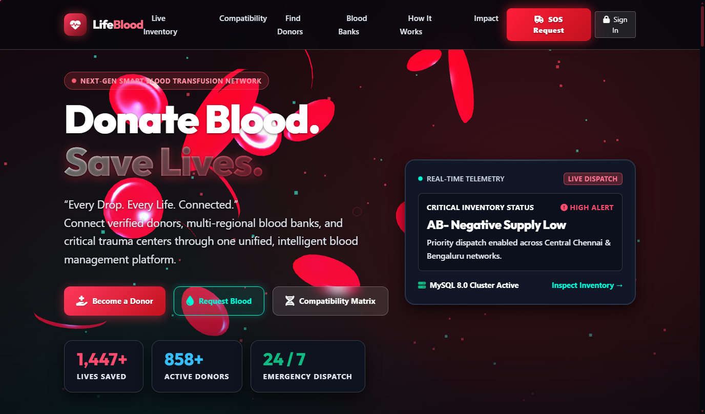
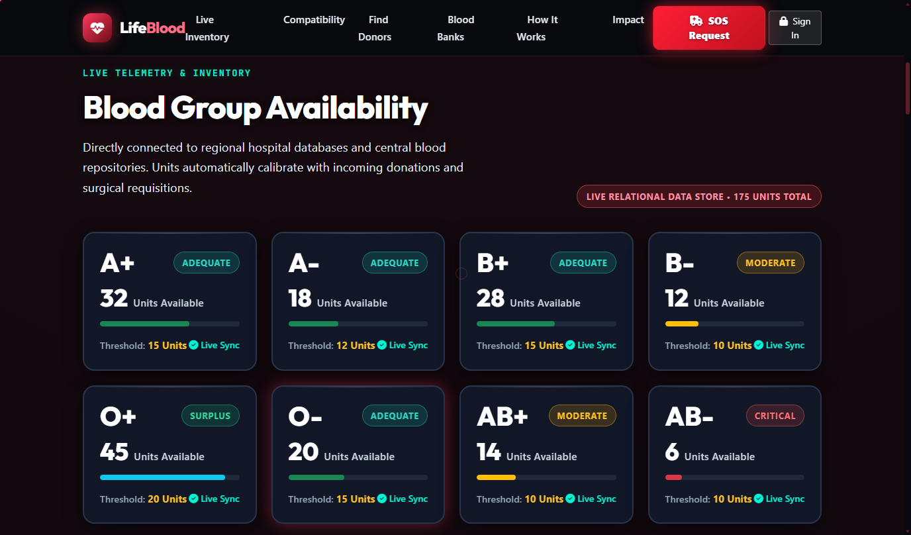
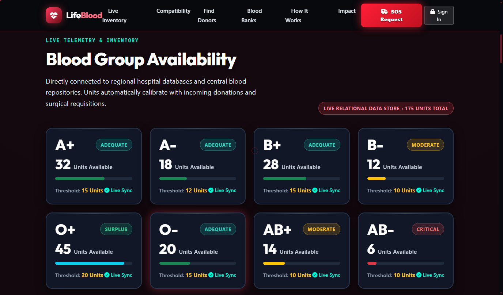
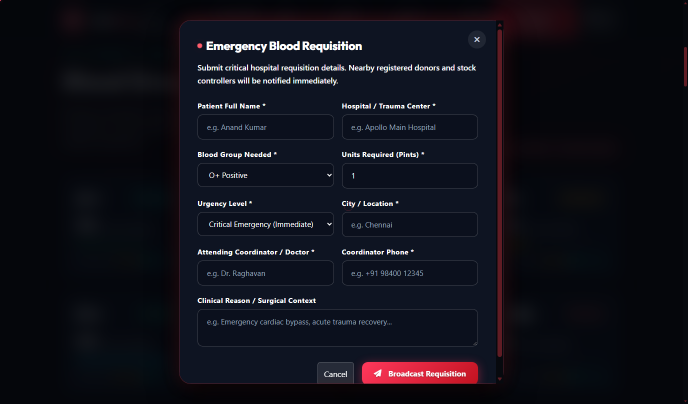
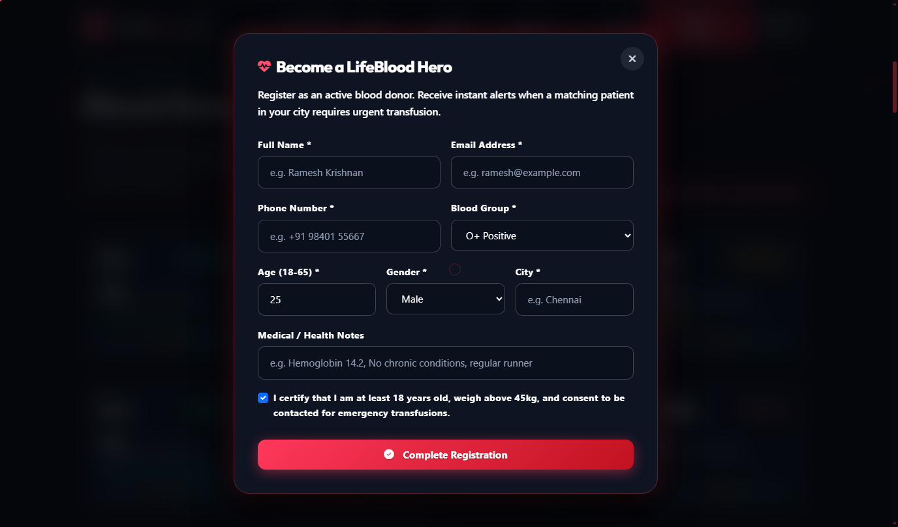
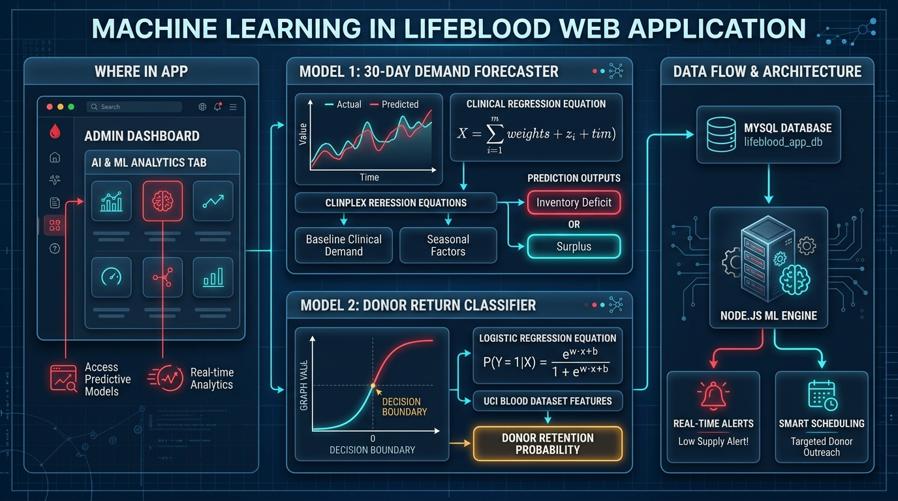

# LifeBlood - Smart Blood Management System

A production-ready, full-stack intelligent blood donation and transfusion coordination platform connecting verified donors, accredited regional blood banks, and critical hospital trauma centers with real-time inventory tracking, clinical compatibility calculations, and emergency SOS broadcasting.

---

## Overview

**LifeBlood** is an intelligent medical healthcare web platform built to eliminate life-threatening delays in emergency blood procurement. The platform centralizes blood bank inventories across multiple facilities, provides an interactive ABO/Rh transfusion compatibility visualizer, enables volunteer donor registration, and features a rapid SOS dispatch engine with automated tracking IDs. LifeBlood features a high-performance modern UI rendered with WebGL (Three.js) interactive cell simulations and a robust Node.js/Express REST backend backed by relational MySQL.

---

## Features

- **Futuristic Medical UI & 3D Interactive Experience**:
  - Three.js WebGL canvas simulating floating erythrocytes (red blood cells) and glowing plasma micro-particles reacting to mouse movement and scroll depth.
  - Custom magnetic cursor experience on CTAs with mobile touch fallback.
  - Responsive dark design system with glassmorphic cards and clinical status tags.
- **Real-Time Database-Driven Blood Inventory**:
  - Live stock tracking across all 8 major blood groups (`A+`, `A-`, `B+`, `B-`, `O+`, `O-`, `AB+`, `AB-`).
  - Automated threshold status indicators: *Surplus*, *Adequate*, *Moderate*, and *Critical Low*.
  - Live background synchronization with zero downtime.
- **Interactive Clinical Compatibility Visualizer**:
  - Dynamic ABO and Rh-factor matrix calculating reciprocal "Can Donate To" and "Can Receive From" groups with clinical transfusion safety notes.
- **Emergency Blood SOS Engine**:
  - Rapid emergency requisition form generating unique tracking codes (`REQ-2026-XXXX`).
  - Priority triage based on urgency tiers (*Critical Emergency*, *Urgent*, *Standard*).
- **Verified Volunteer Donor Network**:
  - Donor registry filtered by blood group and city.
  - Donor self-registration with health checklist and frequency eligibility validation.
  - Interactive Digital Hero Pass / Donor ID card generator.
- **Role-Based Admin Dashboard**:
  - Secure JWT authentication with role-based middleware guards.
  - Inventory quantity adjustment and audit log logging.
  - Emergency request workflow management (*Pending* &rarr; *Approved* &rarr; *Dispatched* &rarr; *Fulfilled*) with dynamic inventory deductions.
- **Dual-Backend Support**:
  - Primary production backend: Node.js + Express.js REST API with MySQL connection pooling (`mysql2/promise`).
  - Alternative backend: Python + Flask (`app.py`) for Python-based environments.

---

## Technologies Used

- **Frontend**:
  - HTML5
  - CSS3 (Responsive Design, Glassmorphism, CSS Variables, Animations)
  - JavaScript (ES6+)
  - Bootstrap 5 (Responsive Grid and Modal Components)
  - Three.js (WebGL 3D dynamic blood cell simulation)
  - GSAP (Fluid timeline animations)
  - FontAwesome 6 (Vector icons)
- **Backend**:
  - Node.js & Express.js (High-concurrency RESTful API server)
  - Python 3 & Flask (Alternative micro-framework backend)
  - Helmet & CORS (HTTP header security & cross-origin policies)
  - Morgan (HTTP request logger)
- **Database & Storage**:
  - MySQL 8.0 (Relational schema with connection pooling via `mysql2/promise`)
  - Parameterized queries to prevent SQL injection vulnerabilities
- **Authentication & Security**:
  - JSON Web Tokens (JWT) for stateless authenticated sessions
  - bcryptjs (Cost factor 10 password hashing)
  - dotenv (Secure environment variable management)

---

## Project Structure

```
lifeblood-management-website/
├── database/
│   └── schema.sql                 # Relational MySQL DDL schema and initial seed records
├── scripts/
│   ├── setup-db.js                # Automated DB creation, bcrypt hashing, and migrations
│   ├── test_qa.py                 # Automated API and integration test suite
│   ├── capture_report_screenshots.js # Automated screenshot utility
│   └── build_final_pdf.js         # Academic report compilation script
├── server/
│   ├── config/
│   │   └── db.js                  # MySQL connection pool with resilient fallback
│   ├── middleware/
│   │   └── auth.js                # JWT verification and role-based guards
│   ├── controllers/
│   │   ├── authController.js      # User registration, login, profile retrieval
│   │   ├── inventoryController.js # Real-time stock counts and threshold monitoring
│   │   ├── donorController.js     # Donor search, registration, eligibility check
│   │   ├── requestController.js   # Emergency SOS broadcast, tracking, status triage
│   │   ├── bankController.js      # Regional blood bank directory
│   │   └── statsController.js     # Platform metrics and system telemetry
│   └── server.js                  # Main Express app, middleware configuration, static routing
├── public/
│   ├── css/
│   │   └── styles.css             # Futuristic dark medical design system
│   ├── js/
│   │   ├── canvas-3d.js           # Three.js 3D floating blood cells and particles
│   │   └── app.js                 # Client-side routing, live inventory, SOS forms
│   ├── images/
│   │   └── screenshots/           # High-resolution application screenshots
│   ├── index.html                 # Master single-page application storefront
│   └── login.html                 # Donor, Hospital, and Administrator portal
├── app.py                         # Alternative Python Flask backend server
├── package.json                   # NPM dependencies and project scripts
├── package-lock.json              # Deterministic NPM lockfile
├── .env.example                   # Environment configuration template
├── .gitignore                     # Git rules excluding node_modules, secrets, and caches
├── START_PROJECT.bat              # One-click Windows launch script
└── README.md                      # Comprehensive project documentation
```

---

## Installation & Setup

### 1. Prerequisites
- Node.js (v18+) and npm installed
- MySQL Server (v8.0+) running locally on port 3306 or 3305

### 2. Clone the Repository
```bash
git clone https://github.com/saro053-prog/lifeblood-management-website.git
cd lifeblood-management-website
```

### 3. Install Node.js Dependencies
```bash
npm install
```

### 4. Configure Environment Variables
Copy `.env.example` to create your local `.env`:
```bash
cp .env.example .env
```
Update `.env` with your local database credentials:
```env
PORT=5000
NODE_ENV=development
DB_HOST=localhost
DB_PORT=3306
DB_USER=root
DB_PASSWORD=your_mysql_password_here
DB_NAME=lifeblood_db
JWT_SECRET=your_jwt_secret_key
JWT_EXPIRES_IN=7d
```

### 5. Initialize & Seed Database
Run the automated migration and database seeder script:
```bash
npm run setup-db
```
*This command creates the database, applies `database/schema.sql`, generates bcrypt password hashes, and seeds initial blood stocks and donor records.*

### 6. Run the Application
You can run the application with either Node.js or Python:

#### Option A: Node.js (Recommended)
```bash
# Production start
npm start

# Or with nodemon (development)
npm run dev
```

#### Option B: Python Flask Backend
```bash
python app.py
```

---

## Usage

1. Open your browser and navigate to:
   - Portal: [http://localhost:5000](http://localhost:5000)
   - Staff Login: [http://localhost:5000/login](http://localhost:5000/login)
2. **Default Demo Credentials**:
   - **Administrator**: `admin@lifeblood.org` | `Admin@123`
   - **Donor**: `karthik@example.com` | `Donor@123`
   - **Hospital Partner**: `emergency@apollo.org` | `Hospital@123`
3. Browse the live inventory, check transfusion compatibility, test the SOS broadcast form, or log in to access administrative inventory triage.

---

## Screenshots

| Portal Hero & Navigation | Live Blood Inventory Grid |
|:---:|:---:|
|  |  |

| Demand Forecasting Analytics | Emergency SOS Broadcast Form |
|:---:|:---:|
|  |  |

| Volunteer Donor Registration | System Architecture |
|:---:|:---:|
|  |  |

---

## Future Improvements

- [ ] GPS-enabled real-time ambulance dispatch integration.
- [ ] Automated SMS / WhatsApp alerts to nearby matched donors when an emergency SOS is triggered.
- [ ] Integration with cold-chain IoT temperature sensors for blood transport bags.
- [ ] Multi-hospital regional blood exchange federation.
- [ ] Biometric donor check-in at physical donation camps.

---

## Author

**V. Saravanapandi**  
- GitHub: [@saro053-prog](https://github.com/saro053-prog)
- Email: [saro77057@gmail.com](mailto:saro77057@gmail.com)
