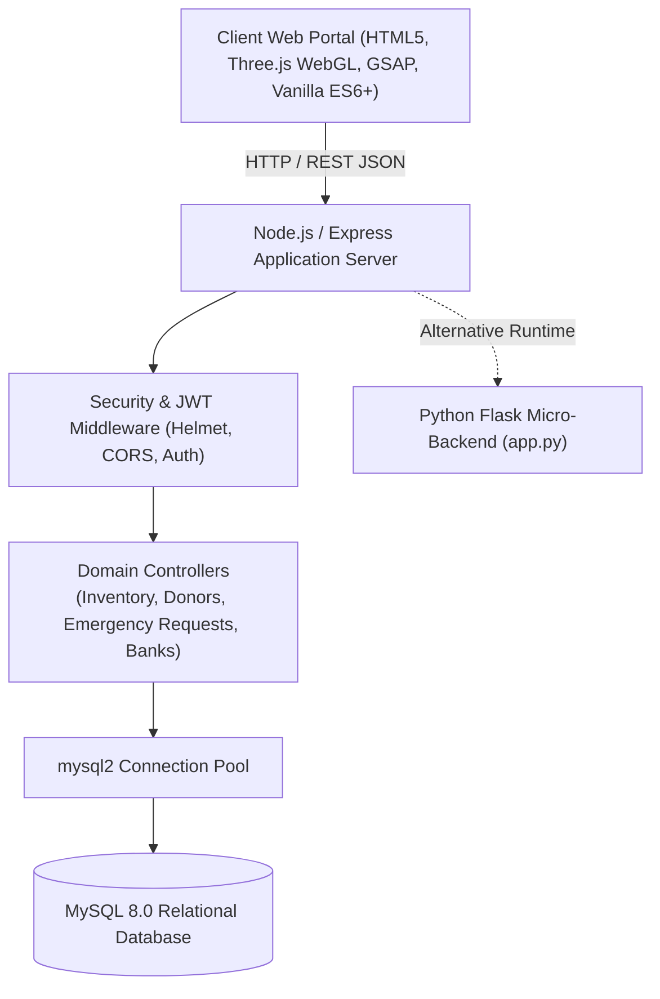
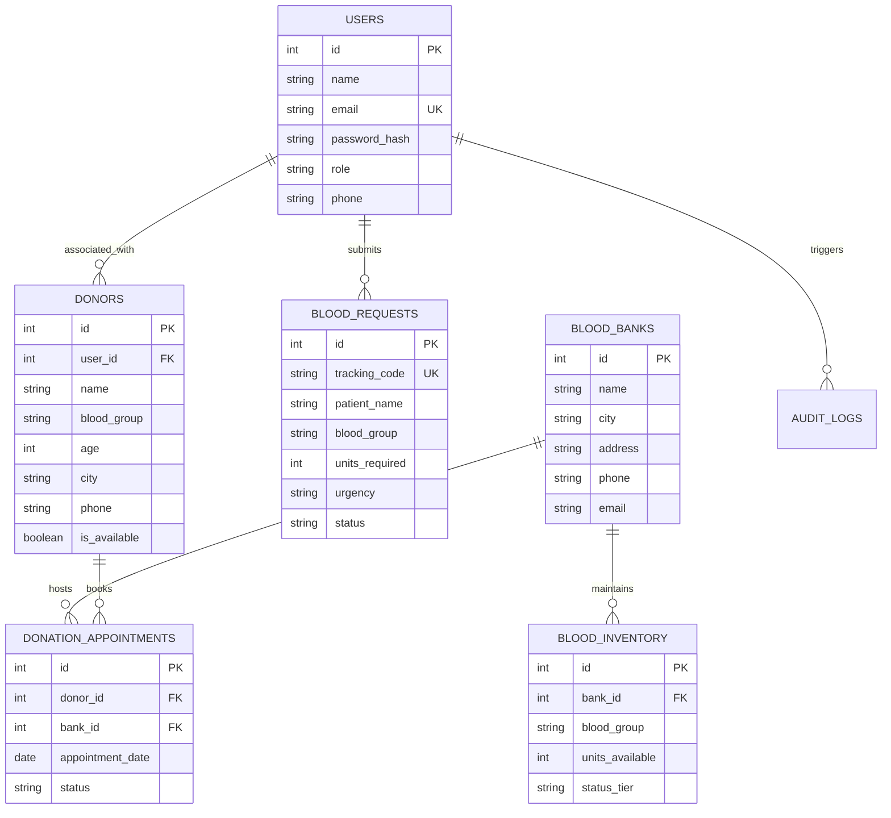

# LifeBlood - System Architecture & Technical Specifications

## 1. High-Level Architecture

LifeBlood is architected as an asynchronous, event-driven healthcare platform connecting volunteer donors, regional blood banks, and hospital trauma centers in real time.

---

## 2. Relational Entity-Relationship (ER) Model

---

## 3. Clinical & Real-Time Specifications

1. **Clinical Compatibility Matrix**: Dynamic client-side evaluator calculating ABO/Rh reciprocal compatibility ("Can Donate To" / "Can Receive From") to assist emergency trauma units during blood shortages.
2. **Emergency SOS Triage Engine**: High-priority broadcast engine generating tracking IDs (`REQ-2026-XXXX`) with urgency tiers (*Critical Emergency*, *Urgent*, *Standard*) and direct inventory deductions.
3. **Three.js WebGL Cell Simulation**: GPU-accelerated 3D canvas simulating floating erythrocytes (red blood cells) with dynamic particle kinematics responding to user interaction and scroll depth.
